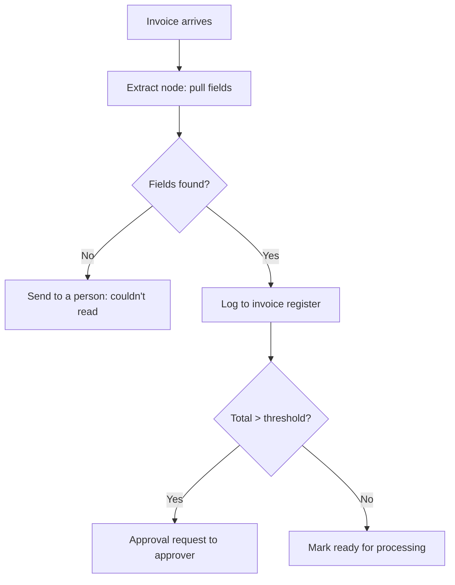

# W3 · Read invoices automatically and route the big ones

**Goal:** when an invoice arrives, pull its key fields out automatically, log them, and send anything over a threshold to the right approver.

**Level:** Advanced · **Licence:** Copilot Studio (usage-based billing, consumes Copilot Credits) · **Last verified:** pending re-test

> ⚠️ **Talk to IT first.** This builds an automation that reads documents and sends messages on its own. It needs Copilot Studio access, it bills on usage, and it touches financial data.

## What you need
- Copilot Studio access in your tenant.
- A shared mailbox or SharePoint folder where invoices land.
- A SharePoint list or Excel table to log extracted invoices. [P7](../prompts/admin-and-coordinators.md#create-a-tracking-list-from-a-plain-english-description) can build the list for you.
- One or two sample invoices (PDF or Office files).
- An agreed approval threshold and approver.

## Steps

**Step 1: set up the trigger**

Create a Copilot Studio workflow triggered by **a new file in [SharePoint folder]** or **a new email with an attachment in [shared mailbox]**.

**Step 2: add an Extract node**

Add an **Extract** node and upload a sample invoice. It will suggest fields. Keep or edit them to:
- supplier
- invoice number
- invoice date
- project / cost code
- line items (description, quantity, rate)
- tax
- total

**Step 3: log it**

Add a step that writes the extracted fields as a new row in your invoice register list.

**Step 4: branch on the total**

Add a **condition**: if the total is greater than [threshold, e.g. 20,000], send an approval request to [approver]. Otherwise, mark it "Ready for processing".

**Step 5: catch failures**

If Extract can't find the total or the supplier, route the invoice to a person with the message "Couldn't read this one". Never skip it silently.

## What can go wrong
- **Scanned or handwritten invoices** extract poorly. Test with your worst real example, not your cleanest one.
- **Line-item tables that span pages** sometimes split into two tables. Check the totals reconcile.
- **Costs scale with volume.** Every run consumes credits. Estimate monthly invoice volume before you switch it on.
- **Extraction isn't approval.** The register says what the invoice *claims*. Use [S3 · Claim checker](../skills/claim-checker/) to compare it with what was *agreed*.
- **Feature drift:** the Extract node arrived in a 2026 Copilot Studio update. Check Microsoft's docs for the current node name and options.

## Related
- [S3 · Claim and invoice checker](../skills/claim-checker/)
- [W1 · Weekly status update on autopilot](weekly-status-autopilot.md), Step 4, for the Copilot node.
