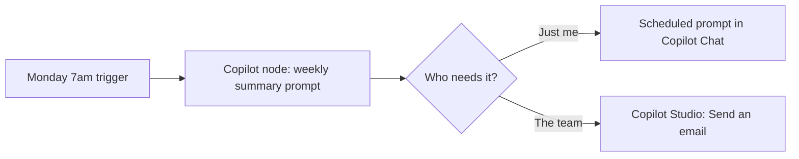

# W1 · Weekly status update on autopilot

**Goal:** a status summary for your project or team arrives every Monday morning before you open your inbox, without you typing a prompt.

**Level:** Beginner · **Licence:** Microsoft 365 Copilot · **Last verified:** pending re-test

## What you need
- A Microsoft 365 Copilot licence (scheduled prompts aren't in free Copilot Chat).
- A prompt you'd otherwise retype every week.
- Optional for Step 4: access to Copilot Studio. This needs an admin, and it bills on usage.

## Steps

**Step 1: write the prompt and run it once by hand**

In Copilot Chat:
> Summarise last week's emails, meetings and files for [project or team name]. Cover: work completed, open questions and who owes the answer, changes or approvals still pending, and anything that puts the timeline at risk. Ten bullets maximum. Link each bullet to its source.

Read the answer. If it's missing something, refine the prompt now. A scheduled prompt repeats your mistakes every week.

**Step 2: schedule it**

Hover over the prompt you just sent, choose **Schedule this prompt**, and set it to **weekly, Monday, 7:00am**. Turn on the email notification if you want it to arrive in your inbox.

**Step 3: read it on Monday**

The result appears in your Chats list (in bold, as unread). Spend two minutes on it, then forward the useful parts or paste them into your team update.

**Step 4 (optional, advanced): send it to the team automatically**

If the whole team needs the summary, build a Copilot Studio workflow with a **schedule trigger → Copilot node** (using the prompt from Step 1) **→ Send an email** step. Put the Copilot node's answer into the email body.

## What can go wrong
- **Cap:** you can only have 10 scheduled prompts per person. Spend them on prompts you actually read.
- **Thin weeks produce padded summaries.** Add "If nothing changed in a category, say 'nothing new'" to the prompt.
- **Step 4 runs as the connected account,** so the summary includes everything *that account* can see. Choose that account carefully, and talk to IT before anything goes to a distribution list.
- **Copilot Studio consumes Copilot Credits** on usage-based billing. A weekly run is cheap, but check before you build ten of them.

## Related
- [S1 · Meeting-to-actions](../skills/meeting-to-actions/): use it for the "open questions" part.
- Teams **Workflows** now includes AI Workflow templates for multi-step Copilot jobs. They're off by default until an admin enables them.
